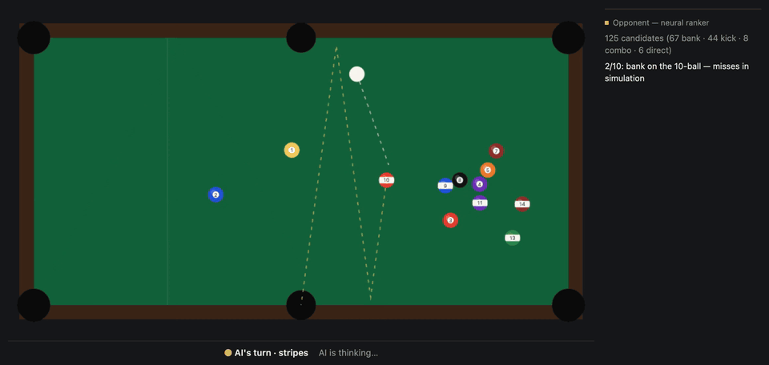

# Showboat

[](https://github.com/adamkuhn1/showboat/actions/workflows/ci.yml)



*A real AI turn, recorded in the game. Dashed lines are shots it is still
checking; the solid line is the route it settled on, and that exact
simulation is what plays. The 10 banks off the far rail into the side
pocket.* There's no hosted demo yet; it runs locally with two commands
(see [Run locally](#run-locally)).

I wanted a pool opponent that plays like the show-off at the bar: it would
rather bank a ball than shoot it straight, but only when the bank actually
goes. Every trick shot it plays has been run through the physics first, and
the panel beside the table shows its thinking while it does that.

## What it does

- Eight-ball on a seven-foot bar table, in the browser, no backend. Bar
  rules: scratch and your opponent gets ball in hand behind the head string;
  any other foul just hands over the table where the cue ball stopped.
- On its turn the AI lists candidate shots (straight, bank, kick, combo),
  scores them with a small trained ranker, simulates the ten best, and plays
  one that actually goes in legally. It only takes a trick shot if it also
  drops in at least 2 of 3 re-runs with a slightly shaky stroke.
- The ranker is a tiny neural net. A hand-written scoring function is the
  fallback, and you can force it with `?ranker=classical` to compare.
- The thinking panel is built from the same data the AI decided with. It
  can't say anything the decision didn't contain.

## How it works

```
game state
  → generate candidates    pure geometry: direct / bank / kick / combo
  → rank                   neural MLP (or classical fallback) scores each
  → verify top 10          full physics simulation, jittered rollouts
  → select                 legal; trick-preferred only if robust (≥ 2/3 under jitter)
  → or play safe           simulated roll-ups, illegal first contacts rejected
  → play + overlay         recorded frames drive playback and the panel
```

- `src/physics/`: event-based simulation. Instead of stepping time in fixed
  ticks, it works out when the next collision, rail hit or slide-to-roll
  change happens and jumps straight there. Trajectories are closed-form,
  following Han (2005) and pooltool.
- `src/game/`: the rules, as a pure function of a shot's result (fouls,
  ball in hand, win/loss).
- `src/ai/`: candidate generation, the ranker, and shot classification. A
  shot only counts as a bank if the simulation shows it really hit a rail,
  not because the generator meant it to.
- `src/render/`: canvas drawing. Playback replays the recorded simulation
  frames; nothing is re-simulated for the animation.

## Things I cared about

- **No jump shots or massé.** `CueAction` has no cue-elevation field at all,
  so those shots can't be expressed, rather than being merely discouraged.
- **The cue ball does what a real one does.** A centre hit leaves the ball
  sliding with no spin (a stun shot stops dead on a full hit), and draw and
  follow come from tip offset, with spin proportional to cue speed
  (ω = 5·v·d / 2R²). Slip closes at 7/2·μg, so a stunned ball picks up
  natural roll at 5/7 of its speed, the textbook number. English at the
  rail has the right sign: running english widens the angle, reverse
  english tightens it. All of this has tests in `src/physics/physics.test.ts`.
- **The cue ball never jumps around.** After a scratch it stays in the
  pocket until someone puts it down behind the line, and the AI's placement
  is animated: the ball rolls out from the head rail to its spot.
- **The trick-shot habit has limits.** `DIRECT_ORDER_DISCOUNT` in
  `src/ai/agent.ts` halves the ranking score of straight shots, which
  decides what gets simulated. Then `selectShot` only prefers a trick shot
  among shots that pass the `ROBUST_FRACTION` bar (2 of 3 jittered re-runs).
  Below that it just takes the most reliable shot.
- **Safeties are simulated too.** When nothing goes, `chooseSafety` tries
  soft roll-ups to each legal ball and throws out any that foul.
- **The held-out split is by table position, not by row.** Every candidate
  from one layout shares its geometry, so splitting by row would leak
  between train and test.

## Results

These numbers come from the dataset as it was generated, before the physics
fixes on this branch (stun, draw and follow, slide-to-roll timing, rail
english). The AI's shots have no spin, so the generated candidates changed
less than you'd think, but the ranker hasn't been retrained on the new engine
yet. The self-play results further down were re-run after the fixes.

The ranker is a 13→20→12→1 MLP (~545 parameters), trained on 9,390 labeled
shot candidates sampled from 260 table positions (208 positions/7,555 rows
train, 26/927 validation, 26/908 held out and never touched until final
evaluation):

| | Neural | Classical |
|---|---|---|
| Held-out BCE | 0.261 | 0.310 |
| Held-out AUC | 0.824 | 0.755 |
| Mean per-position Spearman | 0.280 | 0.130 |

Neural beats classical on all three gate metrics. It only ships as the
default if it does, and `weights.json` records the pass/fail itself so
the app's default can't drift from what evaluation found. Self-play results
are under Evaluation below.

## Evaluation

Held-out test set: **26 table positions, 908 candidate rows** (25 positions
have enough label variance for a per-position Spearman; only 25 rows, from
15 positions, are positives at label > 0.5, which is what AUC counts). The
classical baseline is `classicalScore` in `src/ai/ranker.ts`: a hand-written
multiplicative pot-probability heuristic over the same 13 features, with no
learned parameters.

95% intervals come from a position-level bootstrap (5,000 resamples of the 26
held-out positions, seed 20261001; neural and classical scored on the same
resample, so the differences are paired). Predictions are regenerated from
the shipped weights, and the point estimates match `training/metrics.json`
exactly.

| | Neural | Classical | Neural − classical |
|---|---|---|---|
| AUC | 0.824 (0.749–0.888) | 0.755 (0.653–0.845) | +0.069 (−0.006 to +0.156) |
| BCE | 0.261 (0.216–0.306) | 0.310 (0.248–0.373) | −0.049 (−0.073 to −0.028) |
| Mean Spearman | 0.280 (0.212–0.349) | 0.130 (0.062–0.202) | +0.150 (+0.056 to +0.243) |

The BCE and Spearman gains have intervals that exclude zero. The AUC gain
does not quite (96% of resamples favour neural); with 26 positions it is
suggestive, not established.

**Top-10 recall** (does a candidate that pots in most of its jittered
rollouts land in the 10 the agent verifies, using the agent's real order):
neural 13/15 positions (0.87, 0.67–1.00), classical 11/15 (0.73,
0.50–0.94), a random 10 0.45. This is ranked among the ≤ 40 candidates
sampled per position, not every candidate the game generates, and 15
positions is a small sample.

**Self-play** (neural-ranked vs classical-ranked agent, everything else
identical, seed 42):

- 30 games, after the physics fixes and the switch to bar rules: neural won
  15/30 (50%, Wilson 95% 33–67%). Before them it won 19/30 (63%, 46–78%).
  The intervals overlap a lot, so 30 games can't separate a real drop from
  noise, but the neural edge isn't visible any more. That's the expected
  cost of a ranker trained on the old engine, and the next thing to fix is
  regenerating the dataset and retraining.
- 300 games, before the fixes: neural won 171/300 (57%, Wilson 95% 51–63%),
  about 22 minutes on a laptop. Not re-run yet.

Reproduce with `npm run train:selfplay` (`GAMES=300` for the long run) and
then `npm run train:bootstrap`; everything lands in `training/ci.json`.

## Run locally

```bash
npm install
npm run dev          # http://localhost:5175
npm run build
npm test
npm run typecheck
```

Training scripts (`npm run train:generate|fit|evaluate|selfplay`) regenerate
the dataset and model from scratch; the shipped `src/ai/weights.json` is
already trained. `npm run train:bootstrap` recomputes the confidence
intervals below into `training/ci.json` without touching the weights. Force
the classical ranker with `?ranker=classical`.

`?embed=1` is the portfolio-iframe mode: no title, the host's palette, the
table scaled to the frame width, and the content height posted to the parent
as `{ source: "portfolio-embed", type: "resize", id: "showboat", height }`.

## Limitations

- Bar rules, but without the "shoot out of the kitchen" requirement: after
  placing behind the line you may shoot at any ball.
- Draw and follow use a 2D roll vector rather than full 3D rigid-body spin,
  and cushion rebound is a simplified version of Han's model.
- Rolling resistance (`MU_ROLLING = 0.05`) is set higher than the textbook
  ~0.01 so ordinary shots settle in a few seconds; the table plays a little
  slow.
- Pockets capture any ball whose centre crosses the jaw radius: no liners or
  knuckles, so fast balls never rattle out.
- Safety play is a small simulated search over roll-ups, not a real safety
  strategy.
- Shot power is a heuristic based on path length; the ranker doesn't choose
  it.
- The ranker was trained before the physics fixes and hasn't been
  regenerated against them (see Results).
